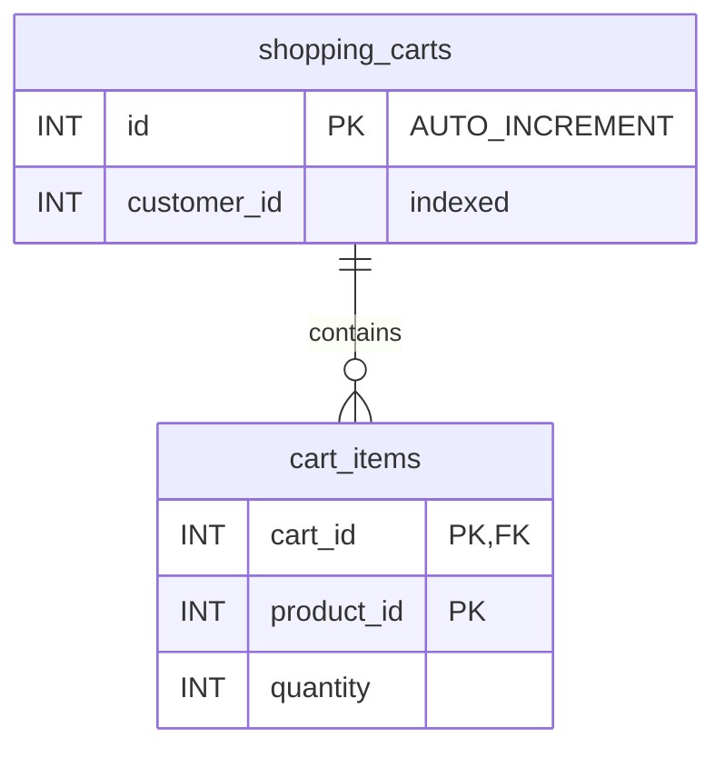

# HW8: Finally... DATA!

## Step I: MySQL Integration for Relational Data

```
Client -> ALB (public subnets) -> Shopping Cart service on ECS Fargate (private subnets) -> RDS MySQL (private subnets)
```

Carts live in MySQL, not in the service's memory, so they survive service restarts and any task can serve any cart.

### API

Endpoints from [`api.yaml`](api.yaml), plus `GET /shopping-carts/{id}`, which HW8 adds. Every error body uses the spec's `Error` schema: `{"error": "<CODE>", "message": "..."}`.

| Endpoint | Success | Errors |
|---|---|---|
| `POST /shopping-carts` | `201` cart with `items: []` | `400 INVALID_INPUT` bad body. `500 INTERNAL_ERROR` database error |
| `GET /shopping-carts/{id}` | `200` cart | `400 INVALID_INPUT` bad id. `404 NOT_FOUND` no such cart. `500 INTERNAL_ERROR` |
| `POST /shopping-carts/{id}/items` | `204`, no body | `400 INVALID_INPUT` bad id or body. `404 NOT_FOUND` no such cart. `500 INTERNAL_ERROR` |
| `GET /health` | `200` with `{"status": "ok"}` | none (does not touch the database) |

On a `500` the service logs the real error to CloudWatch Logs and returns only "Internal server error". SQL errors never reach the client.

**Request bodies** (all numbers are positive `int32`; strings, decimals, `0` and values over the `int32` range get `400`):

`POST /shopping-carts`

```json
{ "customer_id": 42 }
```

`POST /shopping-carts/{id}/items` (adding a product that is already in the cart adds the quantities together)

```json
{ "product_id": 7, "quantity": 2 }
```

**Cart response** (`POST /shopping-carts` returns the same shape with `"items": []`):

```json
{
  "shopping_cart_id": 1,
  "customer_id": 42,
  "items": [
    { "product_id": 7, "quantity": 4 },
    { "product_id": 8, "quantity": 1 }
  ]
}
```

The `{id}` path parameter must be a positive integer, so a path like `/shopping-carts/1 OR 1=1` returns `400` and never reaches SQL. Every SQL statement uses `?` placeholders. Product existence is not checked (there is no products table), and the spec's API key / bearer auth is not implemented, same as HW5–HW7.

### Schema

The service creates both tables at startup with `CREATE TABLE IF NOT EXISTS`. RDS is in a private subnet, so no laptop can run SQL against it.

Two tables, because a cart has many items: `shopping_carts` has one row per cart, and `cart_items` has one row per product in a cart. A cart can grow to 50 items without changing its cart row. There is no customers or products table, because no endpoint needs one.



```sql
CREATE TABLE IF NOT EXISTS shopping_carts (
  id          INT AUTO_INCREMENT PRIMARY KEY,
  customer_id INT NOT NULL,
  INDEX idx_customer_id (customer_id)
)
```

```sql
CREATE TABLE IF NOT EXISTS cart_items (
  cart_id    INT NOT NULL,
  product_id INT NOT NULL,
  quantity   INT NOT NULL,
  PRIMARY KEY (cart_id, product_id),
  FOREIGN KEY (cart_id) REFERENCES shopping_carts(id) ON DELETE CASCADE
)
```

`INT` (signed 32 bit) matches the spec's `int32` fields. InnoDB is the MySQL 8.0 default engine.

**Keys and constraints:**

| Key or constraint | Table | Why |
|---|---|---|
| `id` AUTO_INCREMENT primary key | `shopping_carts` | MySQL generates the cart ID on insert. The service reads it with `LastInsertId()` and returns it as `shopping_cart_id` |
| Primary key `(cart_id, product_id)` | `cart_items` | One row per product per cart, so adding the same product again is a single upsert on that row, not a second line |
| Foreign key `cart_id` → `shopping_carts.id`, `ON DELETE CASCADE` | `cart_items` | An item cannot point to a missing cart (no orphaned items), and deleting a cart deletes its items |
| `NOT NULL` on every column | both | A cart always has a customer. An item always has a cart, a product and a quantity. `quantity` ≥ 1 is enforced by API validation (`min=1`), not by the database |

**Indexes** (one per access pattern):

| Index | Table | Access pattern |
|---|---|---|
| `PRIMARY (id)` | `shopping_carts` | Find a cart by ID |
| `PRIMARY (cart_id, product_id)` | `cart_items` | All items of a cart, through the leftmost column `cart_id`. Also the exact row for the upsert |
| `idx_customer_id (customer_id)` | `shopping_carts` | All carts of a customer (customer history) |

`cart_items.cart_id` needs no separate index: InnoDB requires an index on a foreign key column, and the primary key already starts with `cart_id`, so it serves both the foreign key and the join. No other column is indexed, because there is no other access pattern.

**Queries:**

- `GET /shopping-carts/{id}` reads the cart and all its items in one round trip, so a cart with 50 items costs one query, not 51. `EXPLAIN` shows the `PRIMARY` key on both tables. For an empty cart, `LEFT JOIN` returns one row with `NULL` item columns, so "cart exists, no items" (`"items": []`) is told apart from "cart not found" (no rows, `404`):

  ```sql
  SELECT c.customer_id, i.product_id, i.quantity
  FROM shopping_carts c
  LEFT JOIN cart_items i ON i.cart_id = c.id
  WHERE c.id = ?
  ```

- `POST /shopping-carts/{id}/items` checks the cart, then upserts the item, in one transaction (see Concurrency). The row alias `AS new` needs MySQL 8.0.19 or later and replaces `VALUES(quantity)`, which MySQL 8.0 deprecates:

  ```sql
  SELECT 1 FROM shopping_carts WHERE id = ?
  INSERT INTO cart_items (cart_id, product_id, quantity) VALUES (?, ?, ?) AS new
  ON DUPLICATE KEY UPDATE quantity = cart_items.quantity + new.quantity
  ```

- `POST /shopping-carts` is a single `INSERT INTO shopping_carts (customer_id) VALUES (?)` into one table, so it needs no transaction.
- Customer history would be `SELECT id FROM shopping_carts WHERE customer_id = ?` on `idx_customer_id`. No endpoint calls it, because HW8 lists none.

**Concurrency and transactions:**

- **Different carts:** InnoDB locks rows, not tables. Users working on different carts touch different rows and never wait for each other.
- **Same product in the same cart:** two concurrent adds serialize on that one `cart_items` row, and both increments apply.
- **Add item:** the cart check and the upsert run in one transaction (`BeginTx`, `Commit`, deferred `Rollback`). A missing cart returns `404` and nothing is written.
- **No `SELECT ... FOR UPDATE`:** the upsert is atomic on its row, no endpoint deletes carts, and the foreign key still rejects an item for a missing cart.

### Layout

```
hw8/
├── api.yaml                     # E-commerce OpenAPI spec
├── src/                         # Shopping Cart service (Gin)
│   ├── shopping-cart-service.go # main(): connection pool, schema, routes, GET /health
│   ├── carts.go                 # types, validation, the 3 cart handlers
│   ├── db.go                    # pool settings, openDB(), createSchema()
│   └── Dockerfile
└── terraform/
    ├── main.tf                  # network, ALB, ECR, logs, database, ECS, image build & push
    └── modules/{network,alb,ecr,logging,database,ecs}
```

### Infrastructure

| Requirement | Value | Where |
|---|---|---|
| VPC | `10.0.0.0/16` | `modules/network` |
| Public subnets (ALB) | `10.0.1.0/24`, `10.0.2.0/24` | `modules/network`, `modules/alb` |
| Private subnets (ECS, RDS) | `10.0.10.0/24`, `10.0.11.0/24`, in 2 availability zones | `modules/network`, `modules/ecs` (no public IP), `modules/database` (DB subnet group) |
| NAT gateway | 1, in the first public subnet | `modules/network` |
| Shopping Cart service | ECS service `hw8-shopping-cart`, 256 CPU, 512 MB, `ecs_count` tasks (default 1), behind the ALB | `variables.tf`, `modules/ecs` |
| Health check | `GET /health` returns 200, every 30 s | ALB target group in `modules/alb` |
| RDS engine and class | MySQL 8.0 (current minor version), `db.t3.micro`, 20 GB | `modules/database` |
| RDS placement | Private subnets, `publicly_accessible = false` | `modules/database` |
| RDS security group | `hw8-shopping-cart-rds-sg`: port 3306 from the ECS security group only, no egress | `modules/network` |
| RDS teardown | `skip_final_snapshot = true`, `deletion_protection = false` | `modules/database` |
| Database | `shopping`, user `admin`, password from `TF_VAR_db_password` | `variables.tf` (`db_name`, `db_username`, `db_password`) |
| Connection pool | 10 open, 10 idle, connections recycled after 5 min | `src/db.go` |
| IAM | `LabRole` as task and execution role | `main.tf` |

Terraform passes `DB_ADDR` (the RDS endpoint, `host:3306`), `DB_USER`, `DB_PASSWORD` and `DB_NAME` to the container as environment variables. The password is a plain environment variable, which is acceptable for the homework; production would use Secrets Manager. The ECS service is created only after the database exists.

**Pool size:** each query takes milliseconds, so 10 connections serve far more than 100 shopping sessions. Keeping the cap low also keeps `ecs_count × 10` well under the small connection limit of a `db.t3.micro`.

### Deploy

Start Docker Desktop and refresh your Learner Lab AWS credentials first. Set the database password: 8 to 41 characters, no `/`, `"`, `@` or spaces. Use the **same value on every apply**.

```bash
export TF_VAR_db_password='choose-a-password'
```

```bash
cd hw8/terraform
```

```bash
terraform init
```

```bash
terraform apply
```

Terraform builds the image, pushes it to ECR as `:latest`, creates the RDS instance and then the ECS service. **RDS takes several minutes to create.** Wait until the target is healthy in the target group, and check that the first lines of the `/ecs/hw8-shopping-cart` log group show no `ping database` or `create schema` error. Then:

```bash
curl "$(terraform output -raw alb_url)/health"
```

```bash
curl -X POST "$(terraform output -raw alb_url)/shopping-carts" -H "Content-Type: application/json" -d '{"customer_id":42}'
```

```bash
curl -i -X POST "$(terraform output -raw alb_url)/shopping-carts/1/items" -H "Content-Type: application/json" -d '{"product_id":7,"quantity":2}'
```

```bash
curl "$(terraform output -raw alb_url)/shopping-carts/1"
```

The create call returns `201` with `shopping_cart_id` (1 on a new database; use the returned value in the next two calls), the add call returns `204`, and the get call returns the cart with product 7.

To run two tasks behind the ALB (any task can serve any cart):

```bash
terraform apply -var="ecs_count=2"
```

### Code change after a deploy

The image tag is always `:latest`, so Terraform does not see a code change. Rebuild and push the image:

```bash
terraform apply -replace=docker_image.app -replace=docker_registry_image.app
```

Then start a new deployment so the task pulls the new image: ECS console → Clusters → `hw8-shopping-cart-cluster` → Services → `hw8-shopping-cart` → **Update service** → check **Force new deployment** → **Update**. The carts stay in RDS, so `GET` returns the same cart after the new task starts.

### Local run (MySQL in Docker, no AWS)

Start MySQL 8.0:

```bash
docker run -d --name hw8-mysql -e MYSQL_ROOT_PASSWORD=localpass123 -e MYSQL_DATABASE=shopping -p 3306:3306 mysql:8.0
```

Wait until the log shows `ready for connections` for port 3306 (the first such message is a temporary server):

```bash
docker logs hw8-mysql
```

Run the service:

```bash
cd hw8/src
```

```bash
DB_ADDR=127.0.0.1:3306 DB_USER=root DB_PASSWORD=localpass123 DB_NAME=shopping go run .
```

Then use the curl commands from [Deploy](#deploy) with `http://localhost:8080` instead of `$(terraform output -raw alb_url)`. Check the query plan of `GET`:

```bash
docker exec hw8-mysql mysql -uroot -plocalpass123 shopping -e "EXPLAIN SELECT c.customer_id, i.product_id, i.quantity FROM shopping_carts c LEFT JOIN cart_items i ON i.cart_id = c.id WHERE c.id = 1"
```

Clean up:

```bash
docker rm -f hw8-mysql
```

### Tear down

RDS, the NAT gateway and the ALB cost money while they run. Deleting the RDS instance takes several minutes.

```bash
cd hw8/terraform
```

```bash
terraform destroy -auto-approve
```

### Troubleshooting

| Symptom | Likely cause and fix |
|---|---|
| Task restarts in a loop, log says `ping database` | RDS still creating, wrong `DB_ADDR`, or the RDS security group does not allow the ECS security group |
| Log says `Access denied for user` | `TF_VAR_db_password` changed between applies. Use the value from the first apply, or destroy and recreate |
| `400` on a valid-looking body | Numbers sent as strings, or `Content-Type: application/json` missing |
| Syntax error near `AS new` | MySQL older than 8.0.19. Check `SELECT VERSION()` |
| Local `connection refused` right after `docker run` | MySQL is still starting. Wait for `ready for connections` |
| Code change not deployed | `:latest` tag. Use the `-replace` command above, then force a new deployment |
